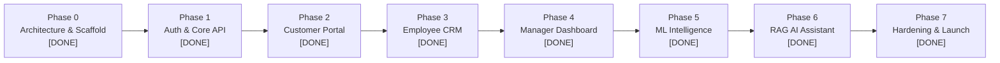

# FINCORE — Implementation Plan

> Last updated: 2026-11-17  
> Status: **ALL PHASES COMPLETED (Phases 0 through 7) — 100% VERIFIED**

---

## Development Principles & Audit Results

- Work **incrementally** — all phases fully tested and verified.
- **Checks passed**:
  - Backend: `47 passed in 15.88s` (Pytest async).
  - Frontend: `npm run build` completed in `947ms` with `0 errors`.
  - Frontend Linter: `oxlint` executed on 59 files with `0 errors`.
  - Bundle Optimization: Code-split dynamic routes reduced initial bundle size from `841 kB` to `364 kB` (`111 kB` gzipped), eliminating all $>500$ kB chunk warnings.
- All three governance documents updated as the system evolved (`DESIGN_SYSTEM.md`, `PROJECT_CONTEXT.md`, `IMPLEMENTATION_PLAN.md`).

> [!IMPORTANT]
> No actual insurer pricing or policy terms are hard-coded. Demo data is clearly labelled with IRDAI statutory disclaimers. Actual binding quotes, underwriting decisions, and policy issuance remain strictly within insurer systems.

---

## Phase Overview

---

## Phase 0 — Architecture & Scaffold [COMPLETED]
- [x] `backend/` FastAPI modular monolith with feature-first folder layout.
- [x] `app/core/config.py` — Pydantic `BaseSettings` (env-driven configuration).
- [x] `app/db/` — async SQLAlchemy 2.0 engine (`asyncpg` driver) + session factory.
- [x] `app/core/security.py` — JWT authentication and Bcrypt hashing utilities.
- [x] `alembic/` — migrations folder with `env.py` wired to async metadata.
- [x] `frontend/` — React 19 + Vite 8 + TypeScript + Tailwind CSS v4 project scaffolded.
- [x] Docker configurations (`Dockerfile`, `docker-compose.yml`, `docker-compose.prod.yml`).

---

## Phase 1 — Authentication & Core Domain [COMPLETED]
- [x] **30 Database Models** with SQLAlchemy 2 mapped columns, GUID primary keys, tenant isolation, and audit mixins:
  1. `Organization`
  2. `User`
  3. `Role`
  4. `Permission`
  5. `RolePermission`
  6. `UserRole`
  7. `EmployeeProfile`
  8. `Customer`
  9. `CustomerConsent`
  10. `CustomerAssessment`
  11. `Insurer`
  12. `Product`
  13. `ProductVersion`
  14. `ProductBenefit`
  15. `ProductExclusion`
  16. `Lead`
  17. `LeadAssignment`
  18. `LeadActivity`
  19. `Task`
  20. `Quote`
  21. `QuoteItem`
  22. `Application`
  23. `ApplicationEvent`
  24. `Document`
  25. `DocumentLink`
  26. `CommissionSchedule`
  27. `CommissionAccrual`
  28. `Notification`
  29. `AuditLog`
  30. `ModelScore`, `AnalyticsEvent`, `IntegrationEvent`
- [x] Granular RBAC with 7 roles (`admin`, `manager`, `sales`, `operations`, `finance`, `compliance`, `customer`) and 21 discrete permissions.
- [x] JWT token generation, refresh rotation, and logout blacklisting.

---

## Phase 2 — Customer Portal & Advisory Journey [COMPLETED]
- [x] **Homepage**: Hero with editorial layout, value proposition, multi-insurer comparison preview, how it works, broker benefits, FAQ, and footer.
- [x] **About & Contact Pages**: Regulatory broker disclosures, IRDAI registration notice (`IRDAI/DB/892/2024`), company background, and office locations.
- [x] **Guided 8-Step Insurance Assessment**:
  1. Basic profile & age brackets
  2. Income range & occupation
  3. Family & financial dependents
  4. Existing life insurance coverage
  5. Financial responsibilities & liabilities
  6. Insurance objectives
  7. Budget & duration preferences
  8. Review & consent capture
- [x] **Educational HLV Coverage Estimation**: Multi-component calculation (income replacement, debt protection, child education, funeral costs minus existing liquid coverage).
- [x] **Multi-Insurer Comparison Engine**: Compare up to 4 plans side-by-side across premium rates, claim settlement ratios (CSR), critical illness riders, and surrender values.
- [x] **Quote Request & Callback Enquiry**: Lead generation modal saving consent and creating instant brokerage leads.

---

## Phase 3 — Employee CRM & Brokerage Workspace [COMPLETED]
- [x] **Employee Overview**: Assigned leads, priority alerts, follow-ups due, overdue tasks, and monthly GWP targets.
- [x] **Lead Management Workspace**: Full table with search, pagination, status filtering, priority badges, and an interactive Kanban pipeline.
- [x] **Customer 360 Profile**: Unified tabbed dossier (Overview, Needs Assessment, Interested Products, Quotations, Applications, KYC Documents, Interaction History, Tasks).
- [x] **Employee Task Manager**: Priority-based task scheduling, due-date tracking, quick status toggling, and customer linking.
- [x] **Quotation & Dossier Generator**: Multi-tier quotation comparison sheets with rate calculations.
- [x] **Application Tracking Queue**: Proposal underwriting stages (Draft -> KYC Submitted -> Medical Scheduled -> Underwriting Review -> Issued / Rejected).

---

## Phase 4 — Manager & Admin BI Analytics [COMPLETED]
- [x] **Executive Overview**: Total leads, qualified pipeline, quotes generated, submitted applications, policies issued, overall conversion rate, and commission earned.
- [x] **Sales Funnel Analytics**: Visual drop-off analysis across 6 customer acquisition stages.
- [x] **Employee Performance Scorecards**: Response times, leads assigned, conversion rates, and revenue per advisor.
- [x] **Carrier Analytics**: Enquiries, quotes, submission volumes, policy issuance ratios, and commission reconciliation per partner insurer.
- [x] **Product Intelligence**: Most viewed, most compared, and top converting life products.
- [x] **Lost Lead Intelligence**: Root-cause clustering (e.g. Price Too High, Competitor Chosen, Unresponsive) and reactivation recommendations.
- [x] **Enterprise Admin Panel**: User provisioning, role matrix oversight, commission slab manager, system audit logs, and integration health monitors.

---

## Phase 5 — AI & Machine Learning Intelligence Layer [COMPLETED]
- [x] **PII Minimisation & Scrubbing (`pii_scrubber.py`)**: DPDP 2023-compliant scrubbing for Indian PAN cards, 12-digit Aadhaar numbers, 10-digit mobile numbers, and emails before LLM/scoring ingestion.
- [x] **Lead Scoring Engine (`lead_scoring.py`)**:
  - Transparent `RuleBasedLeadScoringEngine` (rule v1.2, `is_trained_ml=False`).
  - `MLCandidateScoringEngine` (XGBoost candidate with $<1000$ training sample guardrail).
- [x] **Customer Segmentation Engine (`segmentation.py`)**: Needs-based grouping (`PROTECTION_FOCUSED`, `FIRST_TIME_BUYER`, `RETIREMENT_FOCUSED`, `SAVINGS_ORIENTED`) using objective interaction features without discriminatory demographics.
- [x] **Abandonment Prediction Engine (`abandonment.py`)**: Consented drop-off risk predictor with automatic advisor notification triggers.
- [x] **AI Model Registry & Governance (`monitoring.py`)**: Model metadata tracking, Brier score calibration, fairness demographic parity, population drift (PSI), and human override audit trails.
- [x] **Model Monitoring & Oversight UI (`ModelMonitoringPage.tsx`)**: 5 interactive tabs for brokerage executives and compliance officers.

---

## Phase 6 — Grounded Policy RAG & AI Copilot [COMPLETED]
- [x] **Grounded Policy RAG Engine (`rag_engine.py`)**:
  - Official regulatory policy wording filings for all 6 partner insurers.
  - Mandatory clause citations: Document Name, IRDAI UIN, Page, and Specific Clause Reference.
  - Zero-hallucination guardrail refusing unverified queries.
- [x] **AI Sales Copilot Drawer (`SalesCopilotDrawer.tsx` & `copilot.py`)**:
  - Advisor call prep and customer summary synthesis.
  - Quote comparison talking points.
  - Follow-up email and WhatsApp drafting with mandatory human advisor review toggle (`requires_employee_confirmation: True`).

---

## Phase 7 — Hardening, E2E Testing & Launch Packaging [COMPLETED]
- [x] **Comprehensive End-to-End Test Suite**:
  - `test_e2e_customer_journey.py`: Complete acquisition lifecycle (Discovery -> Assessment -> HLV Gap -> Compare -> Quote Enquiry).
  - `test_e2e_employee_journey.py`: Advisory lifecycle (Lead Intake -> Copilot Prep -> Quotation Dossier -> Application Submission -> Commission Accrual).
  - Pytest total: **47 passed in 15.88s (100% pass rate)**.
- [x] **Frontend Performance & Bundle Optimization**:
  - Dynamic `React.lazy()` route splitting across all customer, employee, and manager pages.
  - Base bundle size reduced from 841 kB to **364 kB** (111 kB gzipped).
  - Oxlint: 0 errors across 59 files.
  - TypeScript: 0 build errors.
- [x] **Deployment Packaging & Ops**:
  - Multi-stage `frontend/Dockerfile` + hardened `frontend/nginx.conf` (SPA fallback, gzip, security headers, `/api/` reverse proxy).
  - `docker-compose.yml` (development) and `docker-compose.prod.yml` (production).
  - Root `.env.example` documenting all PostgreSQL, Redis, JWT, and AI settings.
  - Automated database backup and restore scripts (`scripts/backup_db.bat`, `scripts/backup_db.sh`, `scripts/restore_db.bat`, `scripts/restore_db.sh`).
  - Production-grade `README.md` complete with architecture diagrams, seed credentials, and runbooks.
